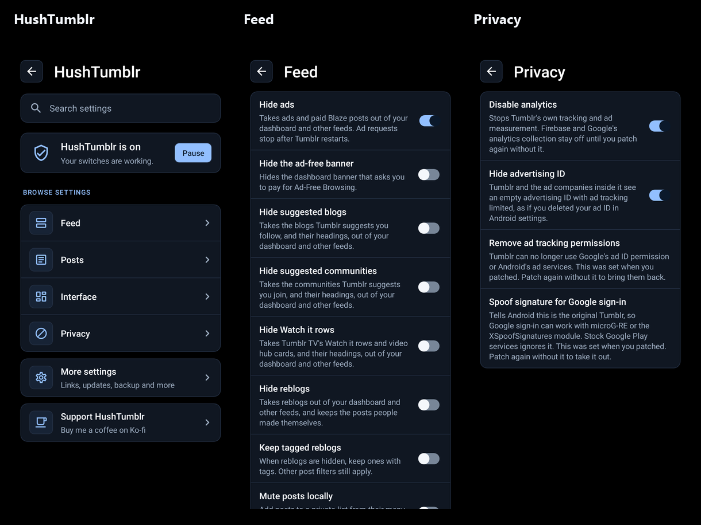

<p align="center">
  
  <a href="LICENSE"></a>
  
  
  
</p>

<p>
  <a href="https://ko-fi.com/X8K126YVER">
    
  </a>
</p>

#  HushTumblr

Morphe patches for Tumblr on Android. The goal is a quieter dashboard, with controls over ads, suggested content and the parts of Tumblr you don't use.

The latest release is [v0.0.1](https://github.com/SysAdminDoc/HushTumblr/releases/tag/v0.0.1), with 36 patches. Add this repo to Morphe Manager as a patch source and it'll offer each new release when it comes out.

## Settings

The v0.0.3 source adds more feed controls and fixes saving, importing and restoring settings. Search and the category pages use dark cards with pale blue controls and room for descriptions. Your saved choices stay the same.



## Supported version

| | Supported |
|---|---|
| App | Tumblr for Android |
| Package | `com.tumblr` |
| Version | **46.5.0.109** |
| Version code | `1460500109` |
| Android | 8.0 or newer |
| Architecture | Any (the bundle carries ARM64, 32-bit ARM and x86 builds) |
| Input | Tumblr's split APK bundle (`.apkm`) |

Every patch is checked against this exact build. Other Tumblr versions aren't supported, and Morphe Manager will call them unsupported.

## Patches

The current source has 42 patches for Tumblr 46.5.0.109. The published v0.0.1 bundle has 36 patches. Newer additions are waiting for the next release.

| Patch | What it does |
|---|---|
| `Dark background color` | Makes the background of Tumblr's Dark Mode palette black, which can save battery on OLED screens, or another dark color you pick when patching. Other palettes stay as they are. Starts off. Turn it on in Tumblr settings > HushTumblr > Interface. |
| `Disable analytics` | Turns off Firebase crash reports and Google's analytics collection, and Tumblr's own tracking and ad measurement once it restarts. The Firebase and Google part stays until you patch again without it. On by default. Turn it off in Tumblr settings > HushTumblr > Privacy. |
| `Disable update prompts` | Stops Tumblr asking Google Play for a newer version and showing Play's update prompt. Starts off. Turn it on in Tumblr settings > HushTumblr > More settings > Updates. |
| `Filter activity notifications` | Hides selected likes, reblogs, replies, follows, mentions, asks and boops from the activity list as pages load. Each switch starts off. Choose them in Tumblr settings > HushTumblr > More settings > Notifications. |
| `Fix push notifications` | Lets the patched app sign up for push notifications. Firebase can refuse a patched Tumblr whose request doesn't name Tumblr's original signature, so this sends its fingerprint. On by default. Turn it off in Tumblr settings > HushTumblr > More settings > Notifications. |
| `Hide Blaze prompts` | Hides the prompts to pay for Blaze, Tumblr's way to promote a post. That covers the Blaze buttons on your blog and dashboard, the nudge after you post, and the Blaze banners. Starts off. Turn it on in Tumblr settings > HushTumblr > Interface. |
| `Hide Tumblr TV` | Takes the Tumblr TV tab out of the bottom bar, and stops sign-up from sending you there. Starts off. Turn it on in Tumblr settings > HushTumblr > Interface. |
| `Hide Watch it rows` | Takes Tumblr TV's Watch it rows and video hub cards out of your dashboard and other feeds, along with their headings. Starts off. Turn it on in Tumblr settings > HushTumblr > Feed. |
| `Hide ads` | Takes ad cards and sponsored posts out of your dashboard and other feeds, and stops Tumblr asking its ad networks for more. On by default. Turn it off in Tumblr settings > HushTumblr > Feed. |
| `Hide advertising ID` | Tumblr and the ad companies inside it see an empty advertising ID with ad tracking limited, as if you'd deleted your ad ID in Android. On by default. Turn it off in Tumblr settings > HushTumblr > Privacy. |
| `Hide hashtags` | Takes the tags off the bottom of posts in your dashboard, other feeds and Tumblr TV, and keeps the source link. Starts off. Turn it on in Tumblr settings > HushTumblr > Posts. |
| `Hide note counts` | Takes the like, reblog and comment counts off the footer under posts, community posts included, and the count off the top of a post's notes. The buttons stay and still work. Starts off. Turn it on in Tumblr settings > HushTumblr > Posts. |
| `Hide photo posts` | Takes photo posts out of your dashboard and other feeds as each page loads. A post with pictures and no video, its reblog trail included, counts as a photo post. Starts off. Turn it on in Tumblr settings > HushTumblr > Feed. |
| `Hide posts with these words` | Hides posts matching your word list. Choose whether to check current text, the reblog trail, tags or summaries. Allowed words can keep a matching post, but other enabled filters still apply. Starts off. Turn it on in Tumblr settings > HushTumblr > Feed. |
| `Hide reblogs` | Takes reblogs out of your dashboard and other feeds as each page loads, and keeps the posts people made themselves. Starts off. Turn it on in Tumblr settings > HushTumblr > Feed. |
| `Hide suggested blogs` | Takes the blogs Tumblr suggests you follow out of your dashboard and other feeds, whether as cards, rows or carousels, along with their headings. Starts off. Turn it on in Tumblr settings > HushTumblr > Feed. |
| `Hide suggested communities` | Takes the communities Tumblr suggests you join out of your dashboard and other feeds, along with their headings. Starts off. Turn it on in Tumblr settings > HushTumblr > Feed. |
| `Hide text posts` | Takes text posts out of your dashboard and other feeds as each page loads. A post with no pictures or video, its reblog trail included, counts as a text post. Starts off. Turn it on in Tumblr settings > HushTumblr > Feed. |
| `Hide the Communities tab` | Takes the Communities tab out of the bottom bar and stops the Communities tips in the post editor. Starts off. Turn it on in Tumblr settings > HushTumblr > Interface. |
| `Hide the Explore tab` | Takes the Explore and search button off the bottom bar. Starts off. Turn it on in Tumblr settings > HushTumblr > Interface. |
| `Hide the Follow button` | Takes the Follow button out of the header of posts from blogs you don't follow yet. Starts off. Turn it on in Tumblr settings > HushTumblr > Posts. |
| `Hide the Notifications tab` | Takes the Notifications button off the bottom bar. Starts off. Turn it on in Tumblr settings > HushTumblr > Interface. |
| `Hide the Save button` | Takes the Save button out of the footer under posts in your dashboard and other feeds, when Tumblr shows one. Starts off. Turn it on in Tumblr settings > HushTumblr > Posts. |
| `Hide the ad-free banner` | Hides the banner on your dashboard that asks you to pay for Ad-Free Browsing. Starts off. Turn it on in Tumblr settings > HushTumblr > Feed. |
| `Hide the comment button` | Takes the comment button out of the footer under posts in your dashboard and other feeds. Starts off. Turn it on in Tumblr settings > HushTumblr > Posts. |
| `Hide the diamond and TumblrMart` | Hides the Premium diamond and the TumblrMart button at the top of your dashboard, Explore and notifications. Starts off. Turn it on in Tumblr settings > HushTumblr > Interface. |
| `Hide the like button` | Takes the like button out of the footer under posts in your dashboard and other feeds, and the reactions off community posts. Starts off. Turn it on in Tumblr settings > HushTumblr > Posts. |
| `Hide the reblog button` | Takes the reblog button out of the footer under posts in your dashboard and other feeds. Starts off. Turn it on in Tumblr settings > HushTumblr > Posts. |
| `Hide the share button` | Takes the share button out of the footer under posts in your dashboard and other feeds. Starts off. Turn it on in Tumblr settings > HushTumblr > Posts. |
| `Hide unread dots` | Hides the unread dots and counts on the bottom bar's Dashboard, Communities and Notifications tabs, with a switch for each tab. Starts off. Turn it on in Tumblr settings > HushTumblr > Interface. |
| `Hide video posts` | Takes video posts out of your dashboard and other feeds as each page loads. A post with a video anywhere in it, its reblog trail included, counts as a video post. Starts off. Turn it on in Tumblr settings > HushTumblr > Feed. |
| `HushTumblr settings` | Adds a HushTumblr page where you turn features on or off, pause HushTumblr, back up your settings and read the licenses. Open it from Tumblr's Settings or by long-pressing the Tumblr icon. Works as soon as you patch it in, with no switch. |
| `Mute posts locally` | Adds a local mute action to post menus. Originals and their reblogs stay hidden for this account. Starts off. Turn it on in Tumblr settings > HushTumblr > Feed. |
| `Remove ad tracking permissions` | Removes Google's advertising ID permission and Android's Privacy Sandbox ad services from Tumblr, so it can't use them. Google Play services then answers with zeros. Works as soon as you patch it in, with no switch. |
| `Reorder the bottom bar` | Puts the bottom bar's tabs in an order you pick, from a list in its settings. Starts off. Turn it on in Tumblr settings > HushTumblr > Interface. |
| `Reveal allowed mature content` | Removes mature-content covers only when Tumblr explicitly allows them for the signed-in adult account. Starts off. Turn it on in Tumblr settings > HushTumblr > Posts. |
| `Show post timestamps` | Shows when posts were made using Tumblr's own timestamp layout. Starts off. Turn it on in Tumblr settings > HushTumblr > Posts. |
| `Show mutual markers` | Marks blogs that follow your primary blog when you follow them. Starts off. Turn it on in Tumblr settings > HushTumblr > Posts. |
| `Skip review prompts` | Stops the pop-up that asks what you think of the Tumblr app and then asks you for a store rating or feedback. Starts off. Turn it on in Tumblr settings > HushTumblr > Interface. |
| `Spoof signature for Google sign-in` | Helps Google sign-in work in the patched app by naming Tumblr's original signature. It only helps with microG-RE or the XSpoofSignatures module. Email sign-in doesn't need it. It isn't selected by default. Works as soon as you patch it in, with no switch. |
| `Turn off screenshot sharing` | Stops Tumblr watching for screenshots, so taking one doesn't bring up its offer to save the post as an image. Starts off. Turn it on in Tumblr settings > HushTumblr > Interface. |
| `Visible image descriptions` | Shows author-provided image descriptions below each image, including galleries and reblogs. Starts off. Turn it on in Tumblr settings > HushTumblr > Posts. |

Morphe Manager selects every patch but Spoof signature for Google sign-in by default. Hide ads, Disable analytics, Hide advertising ID and Fix push notifications start on. Other features start off. The word filter checks all supported fields until you choose otherwise. Remove ad tracking permissions and the signature patch have no switch. Their manifest changes, and the Firebase and Google part of Disable analytics, stay until you patch again without them. The settings patch is required by the others.

Switches change the runtime hooks without patching again. Pause makes those hooks follow Tumblr's original path. HushTumblr settings opens from the HushTumblr row at the end of Tumblr's own Settings screen. The long-press shortcut on the Tumblr icon and Additional settings in the app, on Tumblr's App info page, open it too.

## Privacy

HushTumblr doesn't collect anything and has no server. The release check stays off until you turn it on. Once it's on, HushTumblr asks `api.github.com` for its latest release at most once a day, when Tumblr starts, and again whenever you tap Check now.

Disable analytics changes Tumblr's manifest when you patch: Firebase Analytics, Crashlytics and Performance collection go off, Google Analytics stops collecting the ad ID, and Google's four default consent signals are set to denied. It leaves Firebase messaging and sign-in in place. Its switch also turns off Tumblr's own tracking once Tumblr restarts: LiveRamp's ID on its requests, Open Measurement and Moat ad measurement, and its logs of which features you saw, network use, app performance and ad supply. Hide advertising ID changes the answer Google's ad ID getters give inside Tumblr, so Tumblr's own requests and the bundled ad and analytics SDKs see zeros. It doesn't touch the ad ID other apps see. Remove ad tracking permissions takes Google's advertising ID permission, the Privacy Sandbox ad services permissions and the ad services configuration out of Tumblr's manifest. Hide ads answers no to Tumblr's own switches for asking its ad networks for ads, so those requests stop once Tumblr restarts.

Fix push notifications looks at the address and package of Firebase's own request before Firebase sends it, and swaps only the certificate fingerprint for Tumblr's original one. It doesn't open a connection or send anything itself.

The About and Licenses screens link to `github.com`, `gitlab.com` and `www.gnu.org`, and Support HushTumblr on the settings home links to `ko-fi.com`. The optional setup guide links to password and data help at `help.tumblr.com`. All of these open in your browser, and only when you tap one.

Word rules ignore case and compare NFC-normalized text. Letters, digits, combining marks and connector punctuation keep a word together. Punctuation and emoji can separate words. This does not remove accents or apply language-specific segmentation. Both word lists share the settings backup size limit. Long lists scroll inside the editor. A refused Save keeps your draft.

Muted post IDs stay in a bounded private file on this device, separated by Tumblr account. They aren't included in portable settings backups or diagnostics. The Feed page can clear or manage the current account's list. Unknown account or post identity leaves a post visible.

Mature-content reveal reads Tumblr's existing eligibility service when you opt in. It keeps the blur while the account or its permission is unknown, and after a failed check. It doesn't change Tumblr's eligibility or content-label preferences.

Mutual markers read the followers of your primary blog when you opt in and cache their IDs in memory for the current account. Unknown or stale results leave the header unchanged. Sideblogs don't provide mutual markers.

## Install

1. Install [Morphe Manager](https://github.com/MorpheApp/morphe-manager) 1.34.0 or newer.
2. Add HushTumblr as a patch source: https://morphe.software/add-source?github=SysAdminDoc%2FHushTumblr
3. Get Tumblr 46.5.0.109 from [APKMirror](https://www.apkmirror.com/apk/tumblr-inc/tumblr/tumblr-social-media-art-46-5-0-109-release/). Take the bundle, a .apkm file with version code 1460500109. It carries every kind of phone processor, so there's only one to pick.
4. Pick that file in Morphe Manager, keep the default patch selection and patch. Hide ads, Disable analytics, Hide advertising ID and Fix push notifications start on. Everything else waits until you turn on its switch in HushTumblr settings.
5. Only Spoof signature for Google sign-in is left out. If you need it, turn on **Settings → Advanced → Expert mode** in Morphe Manager and pick it before you patch.

A patched Tumblr can't install over the stock one, because Android only accepts an update signed with the same key. Uninstall stock Tumblr first. Your blogs, posts and follows are in your account and come back when you sign in, but drafts kept only on the phone don't.

## Signing in

Sign in with your email and Tumblr password. Google's sign-in button checks the [app's signing certificate](https://developers.google.com/android/guides/client-auth), and a patched Tumblr carries your own key, so use your email instead. If you joined through Google and never set a Tumblr password, set one first from Tumblr's password reset page, using the email on your account.

## Keep your signing key

Morphe Manager signs the patched Tumblr with a key it makes on your phone. Android installs an update over your patched Tumblr only when the update carries that same key.

- **Back it up right after your first patch.** In Morphe Manager, open Settings, then System, then Import & export, then Signing key, and tap Export. Keep the `Morphe.keystore` file somewhere private, because anyone who has it can sign an APK your phone will accept as an update.
- **On a new phone, import it before you patch anything.** Without your exported copy, nothing you patched earlier can be updated in place.

## Building from source

The project uses Kotlin patches and a Java Android extension. It inherits the Hush build setup and needs JDK 21, the Android SDK, and access to the Morphe packages on GitHub Packages. Set `GITHUB_ACTOR` to your GitHub username and `GITHUB_TOKEN` to a token with `read:packages` access.

```powershell
.\gradlew.bat :patches:generatePatchesList
.\gradlew.bat :patches:buildAndroid
```

The bundle is written to `patches/build/release/`. Generate the patch list first so the Android payload is included.

Focused checks use these tasks:

```powershell
.\gradlew.bat :patches:test :extensions:tumblr:testDebugUnitTest :extensions:tumblr:lintDebug
```

Fixture checks need the Tumblr APK named in `AppCompatibilities.kt` in the folder `HUSHTUMBLR_FIXTURE_DIR` points at:

```powershell
.\gradlew.bat :patches:fixtureTest
```

A successful compile won't establish that a patch works in Tumblr. Applying the patches to the target build and exercising them on Android are separate checks.

## Where the patches come from

| Source | What came from it |
|---|---|
| [SysAdminDoc/HushPinterest](https://github.com/SysAdminDoc/HushPinterest) at `debdac4` | The Gradle build, the shared extension library with its settings screen, diagnostics, pause and backup, the privacy and push notification patches, the bytecode helpers, and the checks that apply every patch to a real APK before a release. Most of that came to HushPinterest from [HushTelegram](https://github.com/SysAdminDoc/HushTelegram), [HushThreads](https://github.com/SysAdminDoc/HushThreads) and [Hushfacebook](https://github.com/SysAdminDoc/Hushfacebook). |
| [Morphe](https://github.com/MorpheApp) and [ReVanced](https://gitlab.com/ReVanced/revanced-patches) | The patcher and the patch template. Everything above grew from their code. |

Tumblr patches written for this project come from reading Tumblr itself. Every source file says where it came from in its header, and [provenance.json](provenance.json) maps each file to the project and commit it came from, with its license. The [source ledger](sources/tumblr-sources.json) is where other Tumblr patch projects get recorded once they've been reviewed.

## Release signing key

Each release signs its `SHA256SUMS.txt` with the HushTumblr release key. Its fingerprint is `2143 368A A5CE 6E5D FFEA  79CF BBC1 3768 83CF 3AB4`, and the public key is [keys/hushtumblr-release.asc](keys/hushtumblr-release.asc). `scripts/verify-release-checksums.ps1` checks a download against it offline.

## Artwork

The navy H icon and poster follow the Hush family style. The poster is brand artwork, not a screenshot of the app. A [social preview](assets/github-social-preview.png) is included, and the original masters and design brief are kept in `concepts/marketing/2026-10-11/`.

## Hush family

| Project | App |
|---|---|
| [HushPinterest](https://github.com/SysAdminDoc/HushPinterest) | Pinterest |
| [HushTelegram](https://github.com/SysAdminDoc/HushTelegram) | Telegram |
| [Hushfeed](https://github.com/SysAdminDoc/hushfeed) | TikTok |
| [HushGram](https://github.com/SysAdminDoc/HushGram) | Instagram |
| [Hushfacebook](https://github.com/SysAdminDoc/Hushfacebook) | Facebook |
| [HushMessenger](https://github.com/SysAdminDoc/HushMessenger) | Messenger |
| [HushThreads](https://github.com/SysAdminDoc/HushThreads) | Threads |

## Credits and license

HushTumblr starts from [HushPinterest](https://github.com/SysAdminDoc/HushPinterest), which carries shared work from HushTelegram and the other Hush projects. The patching tools come from [Morphe](https://github.com/MorpheApp) and [ReVanced](https://gitlab.com/ReVanced/revanced-patches). Source headers keep their upstream attribution.

[GPL-3.0](LICENSE), with the upstream notices in [NOTICE](NOTICE). Tumblr is a trademark of Tumblr, Inc. HushTumblr is an independent project and isn't affiliated with Tumblr.
